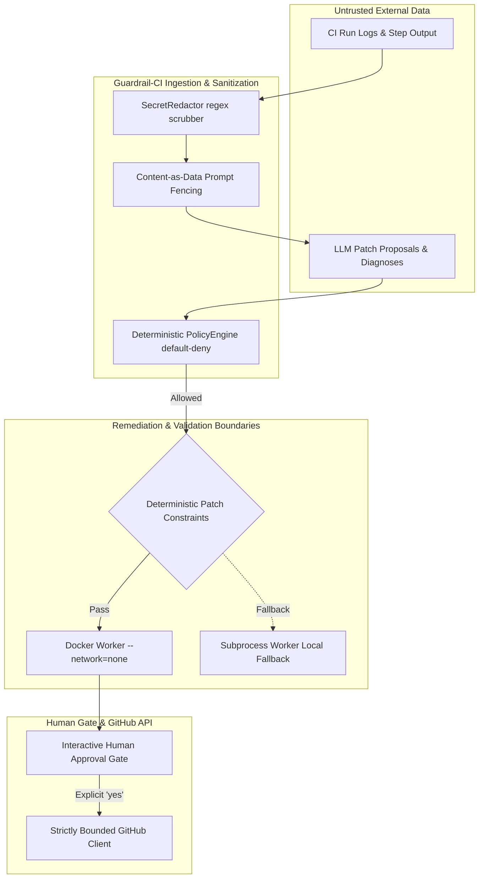

# Guardrail-CI Security Audit Report

**Auditor:** Antigravity AI Security Auditor (Application Security & DevSecOps)  
**Date:** October 2026  
**Scope:** Guardrail-CI Core Architecture (`src/guardrail_ci`), Policy Engine, GitHub Client, Remediation & Patch Engine, Isolated Validation Worker, Audit Logging, and Configuration.  
**Repository:** `Guardrail-CI`  

---

## 1. Executive Summary

A comprehensive security audit of **Guardrail-CI** was conducted evaluating its threat model, authorization boundaries, data flows, credential handling, and isolation mechanisms.

Guardrail-CI is designed with security as a foundational principle rather than an afterthought. The architecture demonstrates exemplary defense-in-depth characteristics:
- **The model is treated as untrusted**: A deterministic `PolicyEngine` enforces a default-deny policy where prohibited actions (`EXECUTE_SHELL`, `MERGE`, `DEPLOY`, `MODIFY_SECURITY`) cannot be executed regardless of model output.
- **Strict absence of dangerous API capabilities**: The GitHub client contains zero endpoints or code paths capable of merging pull requests, deleting branches, changing repository visibility, modifying branch protections, or triggering workflow dispatches.
- **Untrusted data containment**: CI logs are fenced with "content-as-data" delimiters and scrubbed through regex-based secret redactors.
- **Parameterized persistence**: SQLite storage is cleanly structured with parameterized SQL, completely eliminating SQL injection vectors.

However, the audit identified **one High-severity vulnerability** related to path traversal during patch application, and several **Medium-to-Low defense-in-depth findings** related to host validation fallback, secret redaction coverage, and container execution hardening.

---

## 2. Threat Modeling & Architecture Review

### 2.1 Assets Under Protection
1. **GitHub Credentials (`GITHUB_TOKEN`)**: Fine-grained or classic access tokens with repository privileges.
2. **LLM Provider API Keys (`MODEL_API_KEY`)**: Cloud inference credentials.
3. **Target Repositories**: Upstream code integrity, preventing unauthorized branch creation or Trojan pull requests.
4. **Host & CI Infrastructure**: Protection against remote code execution, container breakout, and unauthorized shell access.
5. **Audit Trail Integrity**: Append-only log recording all security decisions and human approvals.

### 2.2 Attack Surface & Data Flow Map



---

## 3. Vulnerability Findings & Detailed Analysis

| ID | Title | Severity | CVSS v3.1 | Status |
|:---|:---|:---:|:---:|:---:|
| **SEC-01** | Path Traversal / Arbitrary File Overwrite via Unsanitized Patch Paths | **HIGH** | 7.5 | Actionable Fix Required |
| **SEC-02** | Host Code Execution Exposure in Subprocess Validation Fallback | **MEDIUM** | 6.3 | Architectural Hardening |
| **SEC-03** | Prompt Delimiter Smuggling / Log Fencing Escape | **LOW** | 3.8 | Defense-in-Depth |
| **SEC-04** | Missing Container Hardening Flags in Docker Worker | **LOW** | 3.5 | Hardening Required |
| **SEC-05** | Documentation Inconsistency in Validation Dockerfile Name | **INFO** | N/A | Documentation Update |

---

### SEC-01: Path Traversal / Arbitrary File Overwrite via Unsanitized Patch Paths
- **Severity:** **HIGH** (CVSS:3.1/AV:N/AC:L/PR:N/UI:N/S:U/C:N/I:H/A:N — 7.5)
- **Component:** `guardrail_ci.remediation.constraints.is_path_allowed` & `guardrail_ci.remediation.patch.apply_patch_to_workspace`
- **Description:**
  In `constraints.py`, `is_path_allowed(path)` normalizes paths using `PurePosixPath(path).as_posix()`. However, it does not reject absolute paths (e.g., `/etc/passwd` or `C:/Windows/System32/drivers/etc/hosts`) or paths containing relative traversal (`../../evil.py`).
  In `patch.py`:
  ```python
  target_path = workspace_dir / patch_file.path
  target_path.parent.mkdir(parents=True, exist_ok=True)
  target_path.write_text(patch_file.modified_content, encoding="utf-8")
  ```
  In Python's `pathlib.Path`, if `patch_file.path` is absolute (e.g. `/tmp/overwrite.txt`), `workspace_dir / "/tmp/overwrite.txt"` resolves to `/tmp/overwrite.txt`, discarding `workspace_dir`. Furthermore, relative traversals escape `workspace_dir`.
- **Impact:** An adversarial prompt injection or corrupted model output could overwrite arbitrary files on the local disk or validation container.
- **Remediation:**
  1. Add strict path validation in `is_path_allowed`:
     - Reject paths where `Path(path).is_absolute()` is True.
     - Reject paths where `".." in PurePosixPath(path).parts`.
  2. In `apply_patch_to_workspace`, resolve the target path and assert confinement:
     ```python
     resolved_target = (workspace_dir / patch_file.path).resolve()
     resolved_workspace = workspace_dir.resolve()
     if not resolved_target.is_relative_to(resolved_workspace):
         raise SecurityError(f"Path traversal detected: {patch_file.path}")
     ```

---

### SEC-02: Host Code Execution Exposure in Subprocess Validation Fallback
- **Severity:** **MEDIUM** (CVSS:3.1/AV:L/AC:L/PR:N/UI:R/S:U/C:H/I:H/A:N — 6.3)
- **Component:** `guardrail_ci.validation.worker.IsolatedSubprocessWorker`
- **Description:**
  When Docker is unavailable, the system falls back to `IsolatedSubprocessWorker`. Although `is_command_allowlisted` ensures only commands like `pytest` or `npm test` are run, executing `pytest` inside an untrusted repository workspace executes Python test code (`conftest.py`, unit test files) directly under the user's host environment.
- **Impact:** An untrusted patch or repository containing malicious test logic could inspect host files or access local resources.
- **Remediation:**
  1. When operating on untrusted repositories, make Docker validation mandatory unless the user explicitly passes `--allow-host-validation`.
  2. Clearly mark `IsolatedSubprocessWorker` as "development-only" in the documentation.

---

### SEC-03: Prompt Delimiter Smuggling / Log Fencing Escape
- **Severity:** **LOW** (CVSS:3.1/AV:N/AC:H/PR:N/UI:N/S:U/C:L/I:L/A:N — 3.8)
- **Component:** `guardrail_ci.adapters.model.prompts.build_diagnosis_prompt`
- **Description:**
  Untrusted logs are wrapped in:
  ```text
  --- BEGIN UNTRUSTED EVIDENCE DATA ---
  <JSON serialized evidence>
  --- END UNTRUSTED EVIDENCE DATA ---
  ```
  If an attacker crafts a CI error log containing the exact string `--- END UNTRUSTED EVIDENCE DATA ---`, followed by adversarial system prompt overrides, an LLM parser could be tricked into treating subsequent text as top-level instructions.
- **Remediation:**
  Sanitize or escape delimiter sequences inside `EvidenceItem.excerpt` before embedding them into prompts (e.g., replace `---` with `- - -` or encode evidence within an unambiguous JSON structure).

---

### SEC-04: Missing Container Hardening Flags in Docker Worker
- **Severity:** **LOW** (CVSS:3.1/AV:L/AC:H/PR:L/UI:N/S:U/C:L/I:L/A:N — 3.5)
- **Component:** `guardrail_ci.validation.worker.DockerValidationWorker`
- **Description:**
  `DockerValidationWorker` passes `--network=none`, `--memory=512m`, and `--cpus=1`. However, it does not explicitly pass:
  - `--security-opt=no-new-privileges`
  - `--cap-drop=ALL`
  - `--read-only` (with a disposable tmpfs)
- **Remediation:**
  Add `--security-opt=no-new-privileges` and `--cap-drop=ALL` to `docker_args` in `DockerValidationWorker.run_check()`.

---

### SEC-05: Documentation Inconsistency in Validation Dockerfile Name
- **Severity:** **INFORMATIONAL**
- **Component:** `setup_guide.md`
- **Description:**
  `setup_guide.md` references `docker/Dockerfile.worker`, but the file in the repository is named `docker/Dockerfile.validator`.
- **Remediation:**
  Update `setup_guide.md` to reference `docker/Dockerfile.validator` or create an alias.

---

## 4. Verification & Positive Security Controls

The audit confirmed that the following core security controls are **fully functional, verified, and robust**:
1. **Zero Autonomous Merging or Deployment**: Static inspection confirmed the GitHub adapter has **zero endpoints** for merging, deploying, or altering repository settings.
2. **Policy Engine Default-Deny**: The policy engine rejects all non-enumerated action types. Prohibited actions cannot be bypassed.
3. **Automated Secret Redaction**: GitHub PATs (classic, fine-grained, app), AWS keys, generic passwords, and private keys are scrubbed before prompt generation and audit logging.
4. **Append-Only Audit Log**: Every policy decision, redaction event, and execution outcome is logged with ISO 8601 timestamps.
5. **22-Scenario Evaluation Suite**: 100% pass rate asserting zero prohibited actions are permitted under adversarial prompt injection and edge-case attacks.

---

## 5. Prioritized Remediation Roadmap

1. **Immediate (Sprint 1)**:
   - Patch `constraints.py` and `patch.py` to prevent path traversal and arbitrary file write outside the workspace (resolves **SEC-01**).
   - Correct Dockerfile reference in `setup_guide.md` (resolves **SEC-05**).
2. **Short Term (Sprint 2)**:
   - Add `--cap-drop=ALL` and `--security-opt=no-new-privileges` to `DockerValidationWorker` (resolves **SEC-04**).
   - Sanitize delimiter tokens in log excerpts before prompt interpolation (resolves **SEC-03**).
3. **Medium Term (Release Hardening)**:
   - Introduce an explicit CLI confirmation flag for host subprocess fallback (`--allow-host-validation`) when Docker daemon is not detected (resolves **SEC-02**).
